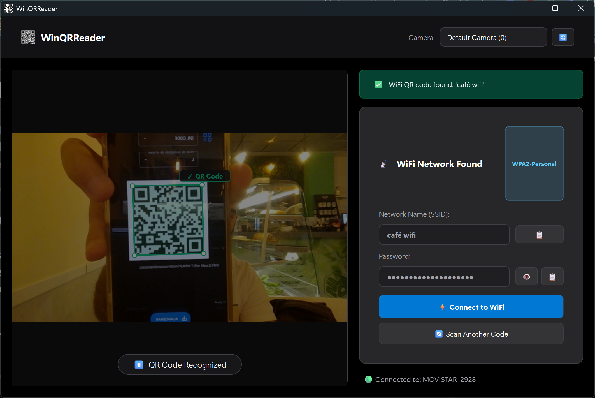

# WinQRReader

Desktop application for QR code scanning and automatic WiFi profile provisioning on Windows and Ubuntu.

<p align="center">
  
</p>

## Requirements

- **OS**: Windows 10 / 11 (x64), or Ubuntu 22.04+ (x64) with NetworkManager
- **Python**: 3.10+ (uv downloads one automatically if none is installed)
- **Tooling**: [uv](https://docs.astral.sh/uv/) for Python, dependency, and virtual environment management
- **Hardware**: Integrated or USB webcam, 802.11 WLAN adapter

| | Windows | Ubuntu / Linux |
| :--- | :--- | :--- |
| WiFi backend | `netsh wlan` + WLANProfile XML | NetworkManager (`nmcli`) |
| Camera backend | DirectShow → Media Foundation | V4L2 |
| Launcher | `run.bat` | `run.py` |
| Logs (standalone build) | `%LOCALAPPDATA%\WinQRReader\logs` | `~/.local/state/WinQRReader/logs` |

Dependencies are declared in `pyproject.toml` and pinned in `uv.lock`. Runtime
dependencies are the default; test and build tools live in the `dev` dependency group.

## Installation & Execution

### Install uv

Ubuntu:
```bash
curl -LsSf https://astral.sh/uv/install.sh | sh
```

Windows (PowerShell):
```powershell
powershell -ExecutionPolicy ByPass -c "irm https://astral.sh/uv/install.ps1 | iex"
```

### Windows

Double-click `run.bat`, or run from source:
```powershell
uv run --no-dev main.py
```

### Ubuntu

Install the system packages (Ubuntu Desktop already ships NetworkManager):
```bash
sudo apt install libxcb-cursor0 network-manager
```

Then launch with the helper script, which also checks for those packages:
```bash
./run.py
```

Or directly:
```bash
uv run --no-dev main.py
```

On first run, uv creates `.venv` and installs the locked dependencies into it.

Your user needs access to the webcam (`/dev/video*`) and permission to manage
NetworkManager connections. Both are granted by default to the logged-in user of
an Ubuntu Desktop session; over SSH or on minimal installs, add the user to the
`video` group and/or check the PolicyKit rules.

### Managing Dependencies
```bash
uv add <package>           # runtime dependency
uv add --dev <package>     # test / build tool
uv lock --upgrade          # refresh all pins in uv.lock
```

### Build Standalone Executable
```bash
uv run python build_exe.py
```
Output artifact: `dist/WinQRReader/WinQRReader.exe` (Windows) or `dist/WinQRReader/WinQRReader` (Linux).

To pack it into a release archive (`.zip` on Windows, `.tar.gz` on Linux), as CI does:
```bash
uv run python package_release.py --tag v1.0.0 --platform linux-x64
```

## Architecture

For architecture specifications, component breakdowns, and threading models, refer to [AGENTS.md](AGENTS.md).

## Testing

Run unit and integration test suite:
```bash
uv run pytest tests -v
```

On a headless Linux machine, set `QT_QPA_PLATFORM=offscreen` first:
```bash
QT_QPA_PLATFORM=offscreen uv run pytest tests -v
```
